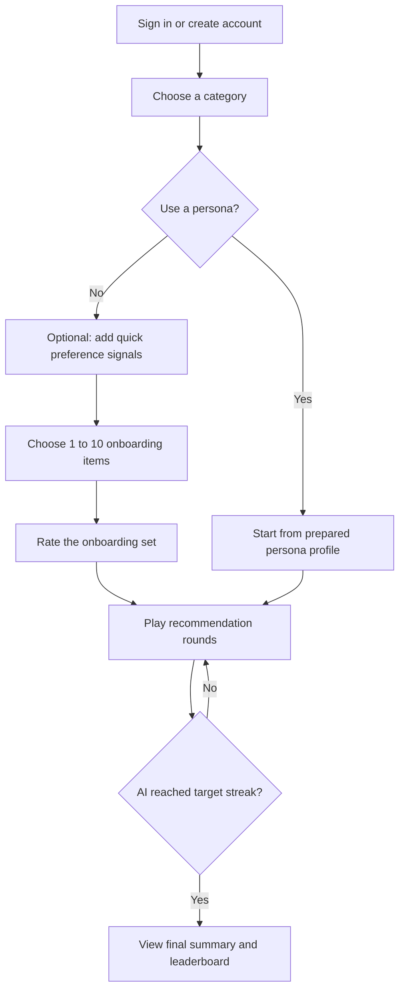

# User Manual

This manual explains how to use Recommendle as a player and, if your account has administrator access, how to use the admin tools.

Recommendle is a recommendation game. You choose items that match your taste, and the AI tries to learn your preferences. The goal is to help the AI match your choices for five rounds in a row.

Current item categories:
- Fountain pens
- Movies
- Games

## 1. Getting Started

Open the Recommendle website in a modern web browser.

If you already have an account:

1. Enter your username.
2. Enter your password.
3. Select `Enter Recommendle`.

If you do not have an account:

1. Select `Sign up`.
2. Enter a username.
3. Enter a display name. This is the name shown on leaderboards.
4. Enter a password of at least 6 characters.
5. Re-enter the password in `Confirm password`.
6. Select `Create account`.

If the username is already taken, choose a different username. If your passwords do not match, re-enter both password fields.

## 2. Main Player Flow

Most users follow this path:

## 3. Choosing A Category

After signing in, the welcome screen shows available categories.

Each category card shows:
- category name
- whether the category is ready
- number of available items
- item type, such as pens, movies, or games

To choose a category:

1. Find the category you want to play.
2. Select the category card.
3. Confirm that the category is marked `Ready`.

If a category is marked `Loading`, wait for the dataset to finish loading or choose another ready category. A category usually needs at least 100 visible items before it is ready.

## 4. Starting A Game

The welcome screen provides two ways to start.

### Option A: Custom Onboarding

Choose `Custom onboarding` if you want the AI to learn directly from your own choices.

1. Select a ready category.
2. Leave `Custom onboarding` selected.
3. Select `Start training`.

If you already have an unfinished run, the main button may say `Continue run`. Select it to resume where you left off.

If you want to discard an unfinished run and begin again, select `Start fresh` when it is available.

### Option B: Start From A Persona

A persona is an admin-prepared profile that already completed onboarding. It lets you skip the initial setup and start playing from a named taste profile.

1. Select a ready category.
2. In `Start from a persona`, choose one of the available persona cards.
3. Select `Start Fresh As <persona name>`.

If no persona cards appear, no playable persona has been prepared for that category yet. Use custom onboarding instead.

## 5. Adding Quick Preference Signals

For custom onboarding, the app may show a `Before onboarding` screen. This step is optional.

Use it when you want to bias the opening item pool before choosing your onboarding set.

You can:
- mark category traits as `Like`
- mark category traits as `Dislike`
- search for specific titles, brands, studios, or games
- add specific items to `Like these`
- add specific items to `Less of these`

To add quick signals:

1. Review the `Quick signals` sections.
2. Select `Like` for traits you want more of.
3. Select `Dislike` for traits you want less of.
4. Optionally search for exact items.
5. Add search results to `Like` or `Less of`.
6. Select `Build my opening pool`.

If you do not want to add quick signals, select `Skip` or `Skip for now`.

## 6. Completing Onboarding

Onboarding asks you to choose 1 to 10 items from a pool of 100. These choices teach the AI what you like.

To complete onboarding:

1. Review the item cards in the grid.
2. Select any item that feels like your taste.
3. Watch the `Selections so far` panel to see your chosen items.
4. Select an item again, or remove it from the side panel, if you change your mind.
5. Choose at least 1 item and no more than 10 items.
6. Select `Continue`.
7. Rate how you feel about the selected set.

If the opening pool does not contain enough useful items, select `Refresh products`. Your current selections remain available while the rest of the pool refreshes.

## 7. Playing Rounds

Each round shows 10 candidate items. You choose your favorite, and the AI tries to rank your choice highly.

The round screen includes:
- `Your active preferences`: items currently shaping the model
- candidate item cards
- current match streak
- `New 10` button for refreshing candidates
- `Lock in <item>` button for submitting your pick

To play a round:

1. Review the 10 candidates.
2. Select the item you like most.
3. If any candidates are especially wrong for you, mark them as less-like-this using the dismiss control on the card.
4. If you want a different candidate set, select `New 10`.
5. Select `Lock in <item>` to submit your choice.

If the AI places your choice in its successful match range, your match streak increases. The default target is 5 matches in a row.

If the AI does not match your choice, the streak may reset, but the game continues and the AI keeps learning.

## 8. Managing Active Preferences

During rounds, the left panel shows `Your active preferences`.

These are the items currently helping the AI understand your taste.

If an item no longer feels representative:

1. Find it in `Your active preferences`.
2. Remove it from the deck.
3. Continue the round with the updated preference profile.

Use this when your earlier picks no longer describe what you want the AI to learn.

## 9. Understanding Round Results

After you lock in a choice, the app shows how your pick compared with the AI recommendation.

The result can include:
- your selected item
- the AI's selected or top-ranked item
- whether the AI matched your preference
- the AI rank of your pick
- explanation signals showing why the model preferred certain candidates
- learned preferences and hidden preference hints

If the result says the AI matched your preference, your streak grows.

If the AI missed your preference, use the explanation to understand what the model may have misunderstood, then keep playing or adjust active preferences in the next round.

## 10. Finishing A Run

A run finishes when the AI reaches the target preference-match streak. The default target is five in a row.

The final summary shows:
- rounds needed to complete the run
- longest match streak
- overall match rate
- round-by-round match chart
- streak progression chart
- learned preference signals
- learned dislikes
- AI top recommendations
- hidden-gem recommendations when available
- category leaderboard

To play again, select `Start another run`.

## 11. Leaderboards And Player History

The welcome screen and final summary include a leaderboard for the selected category.

Leaderboard columns include:
- rank
- player
- rounds
- match rate
- best streak

To view a player's history, select a leaderboard row. The app opens that player's past completed runs for the category when available.

## 12. Account Menu

Your account controls are available from the application header or account menu.

Use the account menu to:
- confirm which account is signed in
- access admin tools if your account is an admin
- sign out

If your session expires, sign in again.

## 13. Administrator Manual

Admin users can access the admin workspace from the app. Admin tools are intended for operators who manage users, product catalogs, persona simulations, and model settings.

If you do not see admin controls, your account does not have administrator access.

### 13.1 Opening The Admin Workspace

1. Sign in with an admin account.
2. Open the account menu.
3. Select the admin option.

The admin workspace header shows the signed-in admin identity.

### 13.2 Products Tab

Use the `Products` tab to inspect category catalogs.

You can:
- choose a category
- search by title or vendor
- filter by an available column
- sort by an available column
- move between pages
- select a product to inspect details
- export the current catalog view as CSV

To inspect products:

1. Open `Products`.
2. Select a category.
3. Use `Search` or `Filter value` to narrow results.
4. Select a product card.
5. Review the detail panel.

To export products:

1. Apply the desired category, search, or filter.
2. Select `Export CSV`.

### 13.3 Users Tab

Use the `Users` tab to inspect and manage accounts.

You can:
- list users
- select a user
- inspect their model profile
- view active or resumable runs
- clear game progress
- delete an account

To inspect a user:

1. Open `Users`.
2. Select a user card.
3. Review profile details, learned preferences, dislikes, hidden affinities, and active preference deck.

To clear game progress:

1. Select a user.
2. Select `Clear game progress`.
3. Confirm the action.

This removes previous and ongoing runs but keeps the account.

To delete a user:

1. Select a user.
2. Select `Delete user account`.
3. Confirm the action.

This permanently removes the account and related game data.

### 13.4 Persona Library Tab

Use `Persona Library` to prepare playable persona profiles.

A persona simulation automatically:
- starts a beta-mode game
- applies the persona's likes and dislikes
- chooses onboarding items
- plays recommendation rounds
- records progress and results
- refreshes the public playable profile if the run completes successfully

To launch a persona run:

1. Open `Persona Library`.
2. Select a named persona.
3. Set `Match streak target`.
4. Set `Max rounds safety cap`.
5. Select `Launch <persona name>`.

If the run completes, that persona becomes available to players on the welcome screen for its category.

### 13.5 Persona Stats Tab

Use `Persona Stats` to monitor persona simulations.

The run list shows:
- persona name
- category
- status
- rounds played
- current streak
- best streak
- whether a playable profile was refreshed

To inspect a run:

1. Open `Persona Stats`.
2. Select a run.
3. Review the live snapshot, scores, final summary, learned preferences, recommendations, hidden gems, and event timeline.
4. Select `Refresh` if you want to update the run list.

Common statuses:
- `queued`: waiting to start
- `starting`: creating the game session
- `seeding`: applying persona preferences
- `onboarding`: completing onboarding choices
- `running`: playing rounds
- `completed`: run succeeded and can refresh the playable profile
- `max_rounds_reached`: run stopped before reaching the target streak
- `failed`: run encountered an error
- `superseded`: a newer run replaced this active run

### 13.6 ML Settings Tab

Use `ML Settings` to view and adjust model parameters.

To update settings:

1. Open `ML Settings`.
2. Edit parameter values.
3. Select `Save ML parameters`.

New rounds use the updated values. Existing completed summaries do not change retroactively.

Change ML settings carefully. Extreme values can make recommendations less useful.

## 14. Troubleshooting For Users

I cannot sign in:
- Confirm your username and password.
- If you forgot your account details, contact an administrator.
- If the session expired, sign in again.

A category says `Loading`:
- Wait for the app to finish loading category data.
- Choose another ready category if available.
- Contact an administrator if the category remains unavailable.

I cannot continue onboarding:
- Select at least 1 item.
- Select no more than 10 items.

I do not see persona choices:
- Personas only appear after an admin has completed a successful persona simulation.
- Use `Custom onboarding` instead.

The AI keeps missing my picks:
- Keep playing so the model receives more feedback.
- Mark poor candidates as less-like-this.
- Remove active preferences that no longer represent your taste.
- Use clearer onboarding choices in a fresh run.

The page shows stale data:
- Refresh the browser.
- Sign out and sign back in.
- Ask an administrator to check backend status if the issue continues.

## 15. Screenshot Guide

The repository does not currently include captured UI screenshots. For a final printed or PDF manual, add screenshots in this section after deployment.

Recommended screenshots:
- Sign in / create account screen
- Welcome screen with category and persona selection
- Quick preference signal screen
- Onboarding item grid with selected items
- Round screen with candidate cards and active preferences
- Round result screen
- Final summary and leaderboard
- Admin products tab
- Admin users tab
- Admin persona stats tab

Suggested annotations:
- Circle the primary action button on each screen.
- Label where the user selects a category or persona.
- Label the onboarding selection count.
- Label the match streak indicator.
- Label admin tabs and destructive actions such as delete user.
